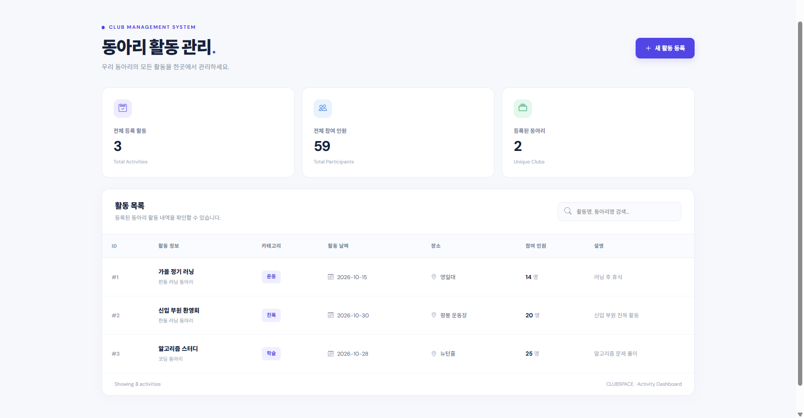
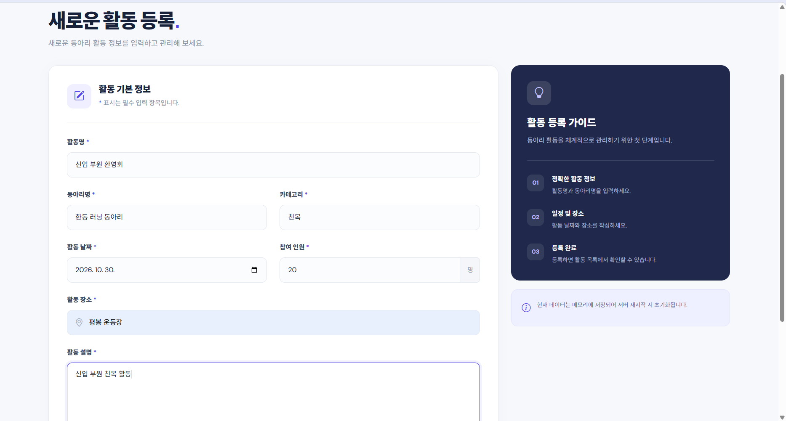
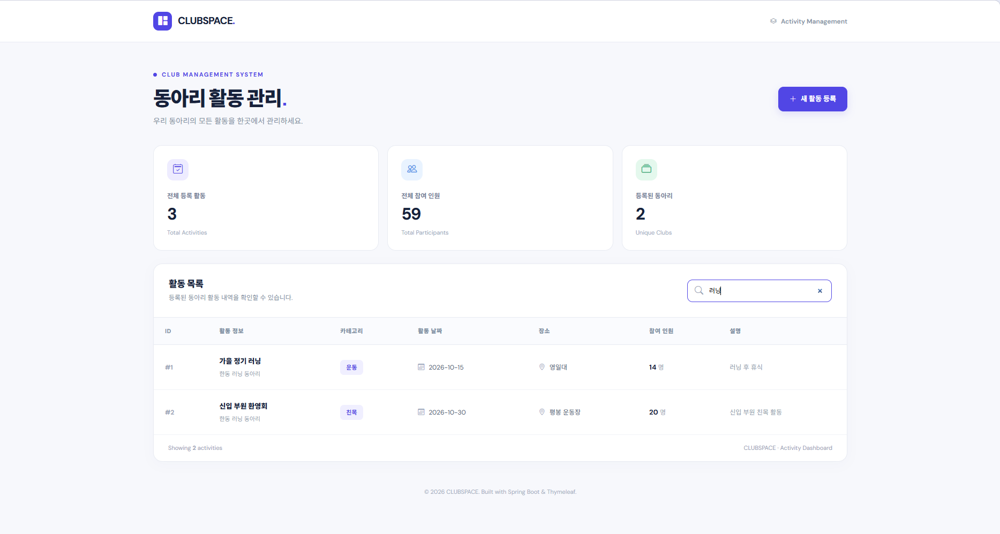
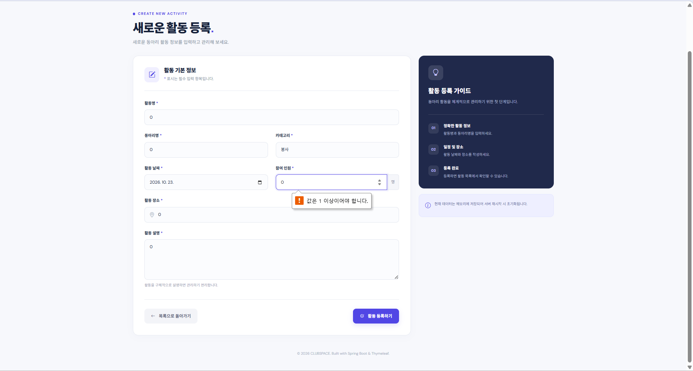

# CLUBSPACE — 동아리 활동 관리 Web UI

> Spring Boot 4.1.1 · Thymeleaf · Bootstrap 5 · Java Collection 기반 Memory CRUD

CLUBSPACE는 동아리 활동을 **웹 브라우저에서 조회하고 등록**할 수 있는 Spring Boot 애플리케이션입니다. 기존 REST API와 Layered Architecture를 유지하면서, Thymeleaf를 이용한 HTML 목록 페이지와 등록 Form을 추가했습니다. 별도의 Database 없이 Java Collection을 저장소로 사용합니다.

## 1. 프로젝트 소개

### 프로젝트 주제 및 주요 기능

- **주제:** 동아리 활동 관리 (Club Activity Management)
- **활동 목록:** 등록된 활동의 ID, 활동명, 동아리명, 카테고리, 날짜, 장소, 참여 인원, 설명 표시
- **활동 등록:** HTML Form에서 7개 입력 항목을 작성하고 POST 요청으로 저장
- **통계 및 검색 UI:** 전체 활동 수, 참여 인원 합계, 등록된 동아리 수 표시 및 활동명/동아리명 기준 클라이언트 측 검색
- **오류 처리:** 잘못된 입력에 대한 검증 메시지 표시(서버 검증 예외 처리), HTML 필수 입력 검증
- **PRG 패턴:** 등록 후 목록 URL로 Redirect하여 새로고침으로 인한 중복 POST 방지
- **기존 REST API 유지:** `/api/activities` 경로에서 JSON 기반 CRUD 제공

### 접속 및 Repository

| 구분 | URL |
| --- | --- |
| **Render 배포 URL** | https://springweek6.onrender.com |
| **배포된 활동 목록** | https://springweek6.onrender.com/activities |
| **배포된 활동 등록** | https://springweek6.onrender.com/activities/new |
| **학교 과제 Repository** | https://github.com/2026-2-WebService/assign06-c01-22200543 |
| **개인 Repository** | https://github.com/eojinleecode/springweek6 |

> **Memory 저장소 안내:** 활동 데이터는 서버 메모리에만 저장되므로 서버 재시작, 재배포 또는 Render 인스턴스 종료 후 초기화됩니다. HTML·CSS·Java 소스코드와 GitHub에 저장된 스크린샷은 유지됩니다.

### 개발 환경

| 항목 | 사용 기술 |
| --- | --- |
| Language | Java 23 |
| Framework | Spring Boot 4.1.1, Spring MVC |
| Build Tool | Gradle Wrapper 9.7.1 |
| View Template | Thymeleaf |
| Frontend | HTML5, CSS3, JavaScript, Bootstrap 5, Bootstrap Icons |
| 저장소 | Java Collection 기반 Memory Repository |
| 테스트 | JUnit 5, Spring Boot Test, MockMvc |
| 배포 | Docker, Render Web Service |

### 프로젝트 구조

```text
spring6/
├── Dockerfile
├── build.gradle
├── settings.gradle
├── gradlew
├── gradlew.bat
├── gradle/wrapper/
├── screenshots/
│   ├── list.png
│   ├── form.png
│   ├── search.png
│   └── error.png
└── src/
    ├── main/
    │   ├── java/org/example/spring6/
    │   │   ├── Spring6Application.java
    │   │   ├── controller/
    │   │   │   ├── ClubActivityController.java       # REST API
    │   │   │   └── ClubActivityWebController.java    # HTML View
    │   │   ├── domain/ClubActivity.java
    │   │   ├── dto/
    │   │   │   ├── ClubActivityRequest.java
    │   │   │   └── ClubActivityResponse.java
    │   │   ├── service/ClubActivityService.java
    │   │   ├── repository/
    │   │   │   ├── ClubActivityRepository.java
    │   │   │   └── ClubActivityMemoryRepository.java
    │   │   └── exception/
    │   │       ├── ActivityNotFoundException.java
    │   │       └── GlobalExceptionHandler.java
    │   └── resources/
    │       ├── application.properties
    │       ├── templates/
    │       │   ├── index.html
    │       │   └── activities/
    │       │       ├── list.html
    │       │       └── form.html
    │       └── static/
    │           ├── css/style.css
    │           └── js/
    └── test/java/org/example/spring6/
        └── Spring6ApplicationTests.java
```

### 실행 방법

**사전 조건:** JDK 23이 설치되어 있어야 합니다. 터미널의 현재 경로는 `spring6` 프로젝트 루트여야 합니다.

Windows PowerShell:

```powershell
.\gradlew.bat bootRun
```

macOS/Linux:

```bash
./gradlew bootRun
```

실행 후 주소:

- 활동 목록: http://localhost:8080/activities
- 활동 등록: http://localhost:8080/activities/new
- REST API: http://localhost:8080/api/activities

자동 테스트 실행(Windows):

```powershell
.\gradlew.bat test
```

종료할 때는 실행 중인 터미널에서 `Ctrl + C`를 누릅니다.

Render에서는 GitHub Repository의 `Dockerfile`로 애플리케이션을 빌드·실행합니다. `application.properties`의 `server.port=${PORT:8080}` 설정으로 Render가 제공하는 포트를 사용합니다.

### Web Endpoint

| HTTP Method | URL | 기능 | 응답 |
| --- | --- | --- | --- |
| GET | `/activities` | 전체 동아리 활동 목록 조회 | `activities/list.html` |
| GET | `/activities/new` | 신규 활동 등록 Form | `activities/form.html` |
| POST | `/activities` | Form 데이터 등록 | 성공 시 `redirect:/activities`; 검증 실패 시 등록 화면 |

참고: REST API는 별도 경로인 `/api/activities`에서 동작합니다.

| HTTP Method | URL | 기존 REST API 기능 |
| --- | --- | --- |
| GET | `/api/activities` | 목록 조회 (`category` 조건 검색 가능) |
| GET | `/api/activities/{id}` | 단건 조회 |
| POST | `/api/activities` | JSON 데이터 등록 |
| PUT | `/api/activities/{id}` | 데이터 수정 |
| DELETE | `/api/activities/{id}` | 데이터 삭제 |

### 데이터 구조

`ClubActivity`는 자동 생성되는 `id` 외에 **7개 필드**를 사용합니다.

| 필드 | 자료형 | 설명 |
| --- | --- | --- |
| `id` | `Long` | 활동 식별자 |
| `title` | `String` | 활동명 |
| `clubName` | `String` | 동아리명 |
| `category` | `String` | 활동 카테고리 |
| `activityDate` | `String` | 활동 날짜 (`yyyy-MM-dd` 문자열) |
| `location` | `String` | 활동 장소 |
| `participants` | `Integer` | 참여 인원 |
| `description` | `String` | 활동 설명 |

## 2. 주요 화면 및 실행 결과

다음 스크린샷은 Render에 배포한 CLUBSPACE 웹 UI의 기능을 확인하기 위해 캡처한 결과입니다.

### ① 활동 목록 화면

활동 목록 Table과 활동 수, 참여 인원, 동아리 수 등 대시보드 통계를 표시합니다.



### ② 활동 등록 화면

7개 입력 항목을 가진 HTML Form에서 신규 동아리 활동을 등록합니다.



### ③ 검색 기능 테스트

활동명과 동아리명을 기준으로 현재 목록을 브라우저에서 필터링합니다.



### ④ 입력 오류 처리

잘못된 등록 입력에 대한 오류 처리 화면입니다.



### 기능 확인 결과

| 기능 | 확인 방법 | 결과 |
| --- | --- | --- |
| GET 목록 | `/activities` 접속 | 배포 페이지에서 목록 화면 확인 |
| GET 등록 Form | `/activities/new` 접속 | 배포 페이지에서 등록 화면 확인 |
| POST 등록 | Form 입력 후 등록 클릭 | 신규 활동의 목록 표시 확인 |
| Redirect / PRG | 등록 후 `/activities` 이동 및 새로고침 | 목록으로 이동하며 새로고침 시 중복 POST가 발생하지 않도록 구성 |
| 목록 검색 | 검색어 입력 | 일치하는 활동만 필터링 |
| 오류 처리 | 잘못된 입력 제출 | 검증 메시지 표시 |
| 자동 테스트 | `./gradlew test` 또는 `gradlew.bat test` | Gradle `BUILD SUCCESSFUL` 확인 |
| Render 배포 | 배포 로그 확인 | Docker 빌드 성공, Spring Boot 시작, 서비스 Live 확인 |

> Redirect 과정 자체는 `screenshots/list.png`만으로 HTTP 응답 코드를 증명하지 않습니다. Controller의 `redirect:/activities`와 MockMvc 테스트를 통해 Redirect 동작을 확인할 수 있습니다.

## 3. 이번 과제 키워드

| 키워드 | 의미 및 이번 프로젝트에서의 사용 |
| --- | --- |
| `@Controller` | 브라우저 요청에 대해 Thymeleaf View 이름을 반환하는 Web Controller |
| **Thymeleaf** | 서버 데이터를 HTML 요소에 연결하는 템플릿 엔진 |
| `Model` | Controller가 조회한 `activities` 목록을 View에 전달 |
| `@ModelAttribute` | HTML Form의 입력값을 `ClubActivityRequest` DTO에 바인딩 |
| **HTML Form** | `POST /activities` 요청으로 활동 데이터를 전송 |
| `redirect:` | 등록 성공 후 `/activities`로 새 GET 요청을 유도 |
| **PRG Pattern** | Post → Redirect → Get 순서로 중복 제출 위험 감소 |
| **Bootstrap 5** | 카드, 반응형 그리드, 테이블, 버튼 및 Form 스타일 적용 |
| **Layered Architecture** | Controller → Service → Repository로 역할을 분리 |

## 4. 핵심 내용 정리

1. **`@Controller`와 `@RestController`의 차이**  
   `@RestController`는 JSON 등의 응답 본문을 반환하는 REST API에 주로 사용하고, `@Controller`는 Thymeleaf View 이름을 반환하여 HTML 화면을 생성하는 데 사용합니다. 기존 REST Controller는 `/api/activities`에 유지하고, 새 Web Controller는 `/activities`에 구현했습니다.

2. **Model을 이용한 Controller → View 데이터 전달**  
   `model.addAttribute("activities", service.findAll())`로 목록 데이터를 전달하고, HTML에서는 `${activities}`를 사용하여 참조했습니다. Controller의 변수명과 View의 변수명이 일치해야 합니다.

3. **Thymeleaf로 Collection을 HTML에 출력**  
   `th:each`로 동아리 활동 목록을 반복하고 `th:text`로 각 활동의 필드 값을 출력했습니다. `th:href`로 목록 및 등록 화면 간 이동 링크를 생성했습니다.

4. **HTML Form과 `@ModelAttribute`의 연결**  
   HTML의 `name="title"`, `name="clubName"` 등 입력 이름을 DTO 필드명과 동일하게 설정하면 Spring MVC가 폼 값을 `ClubActivityRequest`에 바인딩합니다. `participants`는 `Integer`로 변환되고, 날짜는 현재 구현에서 `String`으로 전달됩니다.

5. **Redirect와 PRG 패턴**  
   활동 등록에 성공하면 `return "redirect:/activities";`를 반환하여 POST 요청 뒤 GET 요청으로 목록을 다시 보여줍니다. 사용자가 목록 페이지를 새로고침하더라도 등록 POST 요청을 반복하지 않도록 구성했습니다.

## 5. Weekly Report

### 5.1 Key Learning — 이번 주 배운 핵심 3가지

1. **REST API와 Web UI Controller의 역할 차이:** 같은 Service/Repository를 사용하면서 JSON 응답과 HTML View를 서로 다른 Controller로 구성할 수 있었습니다.
2. **Thymeleaf와 Model 데이터 바인딩:** 서버가 조회한 Collection을 `Model`에 담고, `th:each`와 `th:text`로 HTML Table에 출력하는 방법을 익혔습니다.
3. **Form 처리와 PRG 패턴:** `@ModelAttribute`로 사용자의 입력을 DTO에 전달하고, 등록 성공 후 Redirect하여 목록을 다시 조회하는 과정을 구현했습니다.

### 5.2 Web UI Flow

```text
Browser (GET /activities)
   ↓
ClubActivityWebController
   ↓
ClubActivityService.findAll()
   ↓
ClubActivityRepository (interface)
   ↓
ClubActivityMemoryRepository (Java Collection)
   ↓
List<ClubActivityResponse>
   ↓
Model.addAttribute("activities", ...)
   ↓
Thymeleaf (activities/list.html)
   ↓
HTML Table → Browser
```

Controller는 HTTP 요청과 View 반환을 담당하고, Service는 비즈니스 로직, Repository는 데이터 접근을 담당합니다. Thymeleaf는 Model에 담긴 목록을 HTML로 렌더링합니다.

### 5.3 Form Flow

```text
HTML Form (POST /activities)
   ↓
ClubActivityWebController.create(@ModelAttribute ClubActivityRequest)
   ↓
ClubActivityService.create(request) + 입력 검증
   ↓
ClubActivityRepository.save(...)
   ↓
ClubActivityMemoryRepository (Java Collection 저장)
   ↓
redirect:/activities
   ↓
Browser GET /activities
   ↓
Model → Thymeleaf → HTML 목록
```

### 5.4 Problem & Solution

**문제:** 기존 프로젝트는 `@RestController`를 통해 JSON을 반환하도록 구현되어 있었기 때문에, 웹 브라우저에서 HTML 목록 화면과 입력 Form을 직접 사용할 수 없었습니다.

**해결:** 기존 REST Controller를 유지하면서 `@Controller` 기반의 `ClubActivityWebController`를 추가했습니다. 목록 조회 결과를 `Model`에 담아 Thymeleaf로 전달하고, HTML Form에서 제출한 값을 `@ModelAttribute`로 받도록 구성했습니다. 또한 입력 검증 오류가 발생하면 등록 화면으로 돌아가 메시지를 보여주도록 처리했습니다.

### 5.5 Code Review — 가장 중요한 코드

`ClubActivityWebController.java`의 목록 조회 및 등록 처리 부분입니다.

```java
@GetMapping
public String list(Model model) {
    model.addAttribute("activities", service.findAll());
    return "activities/list";
}

@PostMapping
public String create(@ModelAttribute ClubActivityRequest request,
                     Model model) {
    try {
        service.create(request);
        return "redirect:/activities";
    } catch (IllegalArgumentException e) {
        model.addAttribute("errorMessage", e.getMessage());
        model.addAttribute("formData", request);
        return "activities/form";
    }
}
```

**선정 이유:** 이번 주 학습 목표인 `Model`, `@ModelAttribute`, Thymeleaf View 반환, `redirect:` 및 PRG 패턴을 한곳에서 확인할 수 있는 코드이기 때문입니다. 또한 입력이 유효하지 않을 경우 오류 메시지와 기존 Form 값을 다시 전달하는 흐름을 보여줍니다.

### 5.6 AI Usage

Bootstrap 5를 활용한 목록·등록 화면의 디자인 구성, Thymeleaf 템플릿 초안, CSS 스타일, 테스트 코드 및 오류 처리 방식 검토에 AI 도구를 활용했습니다. 생성된 코드를 그대로 적용하기보다 다음 연결 관계를 직접 점검하고 프로젝트에 맞게 수정했습니다.

- `/books` 예제를 실제 주제에 맞는 `/activities`로 변경하고 Controller 경로를 확인
- `Model` 변수명 `activities`와 Thymeleaf `${activities}`가 일치하는지 확인
- HTML `name`이 `ClubActivityRequest` 필드와 일치하는지 점검
- POST Form action, `@ModelAttribute`, `redirect:/activities`의 연결 확인
- 기존 REST API와 Service/Repository를 유지하면서 Web UI를 추가
- Render 배포 사이트에서 목록, 등록, 검색 및 오류 처리 동작을 직접 확인하고 스크린샷 저장

### 5.7 Reflection

이번 과제를 통해 Spring Boot가 REST API의 JSON뿐 아니라 Thymeleaf를 이용한 서버 렌더링 HTML도 제공할 수 있다는 점을 이해했습니다. 특히 Controller에서 `Model`로 데이터를 넘기고 HTML Form의 입력값을 DTO로 받는 과정이 인상적이었습니다. 추후에는 DB 연동 시에도 같은 Layered Architecture를 어떻게 유지할 수 있는지 더 알아보고 싶습니다.

### 5.8 건의사항

Memory Repository는 Render 무료 인스턴스가 재시작될 때 데이터가 초기화되므로, 배포 환경에서 테스트할 때 데이터 유지와 서버 절전의 차이를 함께 안내해 주면 과제를 이해하는 데 도움이 될 것 같습니다.

---

**제출 정보**

- GitHub Repository: https://github.com/2026-2-WebService/assign06-c01-22200543
- Render URL: https://springweek6.onrender.com
- Weekly Question: LMS에서 별도로 제출
